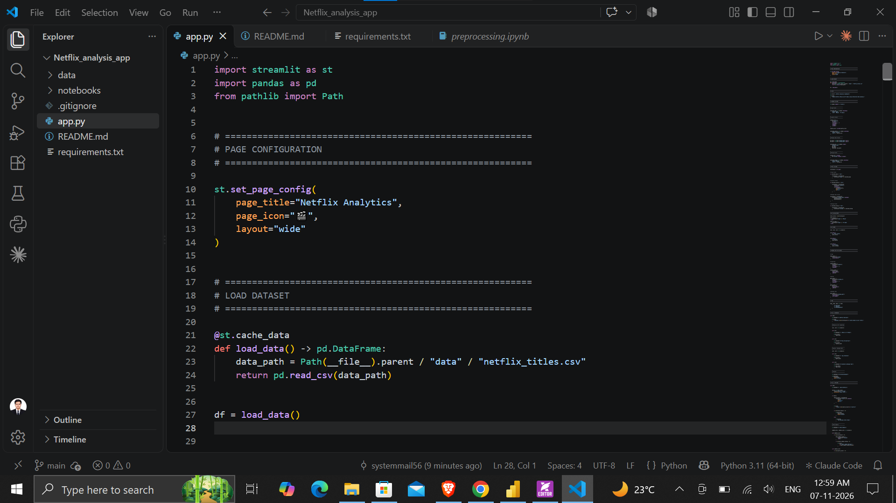
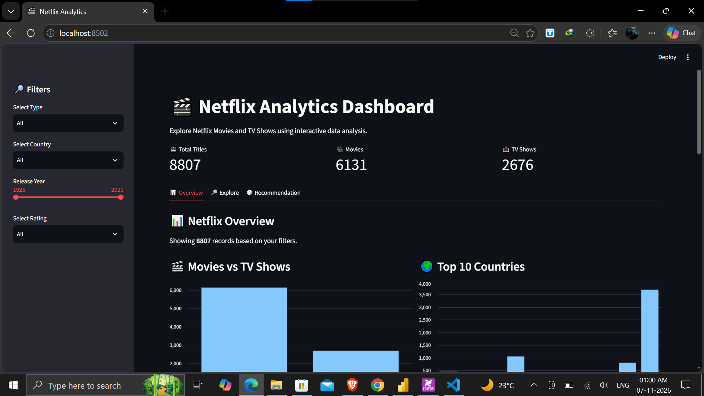
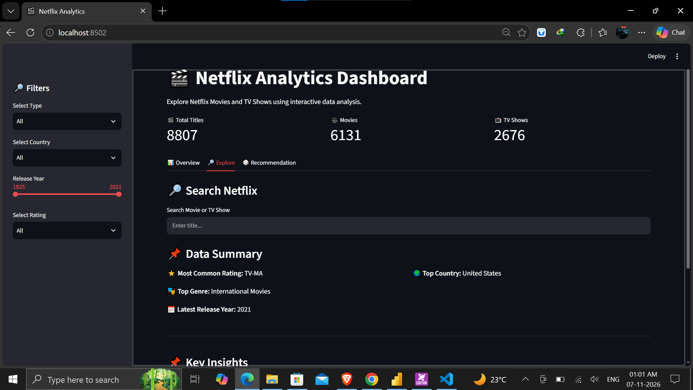
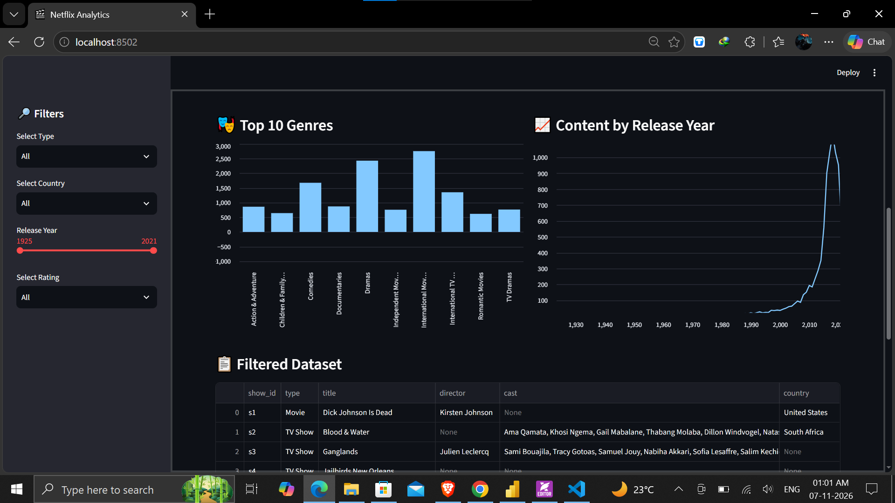

# 🎬 Netflix Analytics Dashboard

An interactive Streamlit dashboard to explore Netflix Movies and TV Shows.

## Features
- **Filters:** type, country, release year range, and rating
- **KPI cards:** total titles, movies, TV shows
- **Overview tab:** Movies vs TV Shows, top 10 countries, top 10 genres, releases by year
- **Explore tab:** title search and data summary
- **Recommendation tab:** random "Surprise Me" pick based on your filters
- **Key insights** that update dynamically with the filters

## Tech Stack
Python · Pandas · Streamlit

## Dataset
[Netflix Movies and TV Shows](https://www.kaggle.com/datasets/shivamb/netflix-shows) from Kaggle (`data/netflix_titles.csv`).

## Project Structure
```
netflix-analytics-dashboard/
├── app.py
├── requirements.txt
├── README.md
├── .gitignore
├── data/
│   └── netflix_titles.csv
└── notebooks/
    └── preprocessing.ipynb
```

## Run Locally
```bash
git clone https://github.com/<your-username>/netflix-analytics-dashboard.git
cd netflix-analytics-dashboard

python -m venv .venv
.venv\Scripts\activate        # Windows
# source .venv/bin/activate   # macOS/Linux

pip install -r requirements.txt
streamlit run app.py
```
The app opens at http://localhost:8501.

> Run it with `streamlit run app.py`, not `python app.py`.

## Screenshots

### Code


### Overview


### Charts


### Explore


### Recommendation



## Author
Your Name · [GitHub](https://github.com/<your-username>)
